# ExamTimer 考核计时录屏器 — 测试报告

* 版本：**1.0.0**
* 被测程序：`ExamTimer.exe`（412,918 字节，mingw-w64 32 位静态链接）
* 目标平台：Windows XP SP3 ~ Windows 11
* 报告日期：2026-09-25

---

## 一、测试环境

| 项目 | 内容 |
| --- | --- |
| 真机被测系统 | **Windows XP Service Pack 3**（5.1.2600，中文版） |
| 主机名 | `RED-03523332AC5` |
| 接入方式 | 局域网 RDP（192.168.1.202，账户 `red`），从 192.168.1.116 远程操作 |
| 分辨率 / 色深 | 1024×768 / **16 位色** |
| CPU / 内存 | 4 处理器 / 2047 MB |
| 关键前置条件 | `C:\WINDOWS\system32\` 中**没有 gdiplus.dll**，也没有 MJPEG VFW 解码器 |
| 宿主机构建环境 | Ubuntu 20.04 + `i686-w64-mingw32-gcc` 9.3（交叉编译出 XP 可执行文件） |
| 辅助验证工具 | ffmpeg 4.2 / ffprobe（解码校验）、Wine 6.1（Windows 7 模式，兼容性代理测试） |

测试过程中在 XP 上部署了一个基于 VBScript + HTTP 的自动化代理（`test/agent.vbs`），
用于远程执行命令、上传下载文件、抓取日志，从而完成下面全部自动化测试。

---

## 二、结论摘要

| 指标 | 结果 |
| --- | --- |
| XP 真机内置自检 | **40 项全部 PASS，0 FAIL** |
| Windows 7 模式（Wine 6.1）自检 | **40 项全部 PASS，0 FAIL** |
| XP 真机录像场景测试 | **14 个场景全部通过**（含分卷、暂停、倒计时、区域、缩放、15fps、INI 配置） |
| 录像文件解码校验 | 12 个 AVI 全部被 ffmpeg 无错解码 |
| 连续录制稳定性 | 65 秒连续录制，**实测 5.00 fps 无丢帧**，内存 9.9 MB |
| 性能 | 1024×768 抓屏+烧录+JPEG 编码平均 **27.7 ms/帧**（5 fps 时约占单核 14%） |

**核心需求验证结论：**

1. ✅ 能录屏 —— 生成标准 MJPEG AVI，多播放器/解码器均可播放；
2. ✅ 计时器醒目、跳秒 —— 大字号 + 高对比配色，默认精确到 0.1 秒，实时跳动；
3. ✅ 默认在屏幕最上方 —— 默认顶部居中（y=0），可配置左/右/自定义；
4. ✅ 不被其他程序遮挡 —— 置顶窗口 + 每 0.5 秒重新置顶，实测**盖在最大化窗口之上**；
5. ✅ 录像里能看到时间 —— 时间**烧录进每一帧**，实测视频画面顶部始终带计时器。

---

## 三、内置自检（`ExamTimer.exe --selftest`）

在 XP 真机上执行，输出 40 项检查，全部 PASS。分类摘要：

```
[environment]        windows 5.1 build 2600 Service Pack 3
                     screen 1024x768, 16 bits, 1 monitors, 4 processors, 2047 MB
[timer formatting]   8/8 PASS   时间格式化与计时精度（含暂停不前进）
[jpeg encoder]       1/1 PASS   自写基线 JPEG 编码器
[avi writer]         9/9 PASS   RIFF/AVI 结构、avih/strh 帧数、movi 内 10 个 JPEG、idx1 索引
[file output]        1/1 PASS   文件写入
[screen capture]     2/2 PASS   BitBlt 抓屏与 BMP 头
[overlay window]    16/16 PASS  见下表
[layered probe]      info        XP 的 BitBlt 抓不到分层窗口 —— 印证烧录方案的必要性
result: 40 passed, 0 failed
```

悬浮计时窗口相关检查（XP 实测值）：

| 检查项 | 结果 |
| --- | --- |
| 窗口创建成功 | PASS |
| 带 `WS_EX_TOPMOST`（置顶） | PASS |
| 带 `WS_EX_TOOLWINDOW`（不占任务栏、不进 Alt+Tab） | PASS |
| 带 `WS_EX_LAYERED`（可调透明度） | PASS |
| 默认带 `WS_EX_TRANSPARENT`（鼠标穿透） | PASS |
| 窗口可见、尺寸合理、不超出屏幕 | PASS |
| **贴在最上边缘** | PASS，`overlay rect = (327,0)-(697,73)` |
| **压过另一个置顶窗口** | PASS，z-order 序号 overlay=0 < rival=3 |
| **压过全屏普通窗口** | PASS，z-order 序号 overlay=0 < fullscreen=21 |
| **鼠标穿透（真实命中测试）** | PASS，`WindowFromPoint` 返回 0x00120190（非计时器窗口） |
| 关闭穿透后能被点中 | PASS，`WindowFromPoint` 返回 0x000A0230（计时器自身） |
| 穿透可反复切换 / 显示隐藏 | PASS |
| XP 的 BitBlt 是否包含分层窗口 | **否** → 必须依赖烧录，程序已内置 |

---

## 四、XP 真机功能场景测试

全部通过程序自身日志 + 回传文件 + ffprobe 三重验证。

| # | 场景 | 命令行要点 | 结果 | 实测数据 |
| --- | --- | --- | --- | --- |
| T1 | 默认全屏录制 | `--fps 5` | ✅ | 1024×768，31 帧 / 6.2 s，2.45 MB，解码无错 |
| T2 | 画面缩放 50% | `--scale 50` | ✅ | 512×384，21 帧，计时器字号同比缩小仍清晰 |
| T3 | 指定区域 | `--region 200,100,400,300` | ✅ | 400×300，计时器被自动约束在画面内 |
| T4 | 倒计时 | `--countdown 30` | ✅ | 画面显示 30 → 27.5 → 25.0（第 0 帧修正后为 30.0） |
| T5 | 左上角 + 秒精度 | `--pos topleft --granularity second` | ✅ | 计时器位于左上角，显示 `00:00:02` |
| T6 | 自动分卷 1 MB | `--split-mb 1` | ✅ | 41 帧切成 **4 个文件**（1.02/1.03/1.03/0.16 MB） |
| T7 | 低质量省空间 | `--quality 40` | ✅ | 同长度下体积明显小于 q75 |
| T8 | 4:4:4 色度 | `--subsample 0` | ✅ | 文字边缘更锐利，体积大于 4:2:0 |
| T9 | 关闭悬浮窗与烧录 | `--no-overlay --no-burnin` | ✅ | 13 帧 / 4.33 s（**该项暴露并修复了一个死锁缺陷**，见第六节 B4） |
| T10 | 高帧率 | `--fps 15 --quality 60` | ✅ | 77 帧 / 5.088 s = **实测 15.13 fps，无丢帧** |
| T11 | 暂停 / 继续 / 停止 | F8、F8、F9 热键 | ✅ | 墙钟 15.6 s，**视频仅 41 帧 / 8.2 s**，暂停期间不录不计时 |
| T12 | 长时间连续录制 | 65 秒 + 持续键盘/鼠标操作 | ✅ | 326 帧，**实测 5.00 fps**，17.9 MB，内存 9.9 MB |
| T13 | 全屏最大化窗口遮挡 | 最大化记事本后观察 | ✅ | 计时器仍绘制在最大化窗口标题栏之上 |
| T14 | INI 配置文件生效 | 自定义 ini | ✅ | 位置/字号/颜色/标签/精度/帧率/质量全部生效 |

### T14 INI 配置验证细节

`examtimer.ini` 内容（UTF-8）：`pos=topleft`、`fontsize=56`、`fg=#00FF40`、`bg=#200020`、
`border=#FF8000`、`label=INI测试标签`、`granularity=second`、`fps=3`、`quality=50`。

录像画面实测为：**左上角**、**绿色**大字、**橙色**边框、**深紫**底色、标签显示
**`INI测试标签`**（中文正确）、时间格式为 `00:00:02`（无小数）——与配置完全一致。
说明程序能够正确读取 UTF-8 的中文 ini（在老系统上也能正确回退到本地代码页）。

### 录像文件完整性校验

回传的 12 个 AVI 全部通过 `ffprobe` + `ffmpeg -f null` 解码：

```
xp_t1.avi        1024x768 5/1  31 帧  6.20s   decode ok
xp_t2.avi         512x384 4/1  21 帧  5.25s   decode ok
xp_t3.avi         400x300 4/1  21 帧  5.25s   decode ok
xp_t4.avi        1024x768 4/1  21 帧  5.25s   decode ok
xp_t5.avi        1024x768 4/1  21 帧  5.25s   decode ok
xp_t6.avi        1024x768 5/1  10 帧  2.00s   decode ok   （分卷第 1 段）
xp_t6_part02.avi 1024x768 5/1  10 帧  2.00s   decode ok   （分卷第 2 段）
xp_t7.avi        1024x768 5/1  26 帧  5.20s   decode ok
xp_t8.avi        1024x768 5/1  26 帧  5.20s   decode ok
xp_t9b.avi       1024x768 3/1  13 帧  4.33s   decode ok
xp_pause.avi     1024x768 5/1  41 帧  8.20s   decode ok   （墙钟 15.6s，暂停已剔除）
xp_long.avi      1024x768 5/1 326 帧 65.20s   decode ok
xp_ini.avi       1024x768 3/1  16 帧  5.33s   decode ok
```

（`xcoded` 全部无 error，`idx1` 索引完整，播放器可任意拖动进度条。）

---

## 五、性能与容量实测（XP SP3，1024×768）

| 指标 | 实测值 |
| --- | --- |
| 单帧耗时（抓屏 + 烧录 + JPEG 编码） | **27.7 ms**（5 fps 场景）／19.6 ms（15 fps + q60 场景） |
| 单帧写盘耗时 | 0.1 ~ 1.3 ms |
| 5 fps 时 CPU 占用 | 约 **14 %（单核）** |
| 10 fps / 15 fps 稳定性 | 15 fps 连续 5 秒实测 15.13 fps，无丢帧 |
| 内存占用 | 录制中 **9.9 MB** |
| 5 fps / q75 / 100% | 约 2.2 Mbps → **约 1.0 GB/小时** |
| 5 fps / q60 / 75% | 约 0.4 GB/小时（估算） |
| 分卷 | 到达设定大小自动换文件，永不触碰 2 GB 上限 |

---

## 六、测试中发现并修复的缺陷

真实机器测试（而不是只做代码走查）一共发现并修复了 8 个缺陷，其中 3 个会导致程序不可用：

| # | 缺陷 | 影响 | 修复 |
| --- | --- | --- | --- |
| B1 | JPEG 头部字节也做了 `0xFF` 填充（byte stuffing） | 生成的 JPEG 无法解码，**录像是废的** | 区分「头部原始写入」与「熵编码填充写入」两条路径；已用 ffmpeg 解码 + PSNR 49 dB 验证 |
| B2 | 计时格式化的 `second` / `hundredth` 精度分支算错 | `01:00:00` 被显示成 `00:10:00` 之类 | 重写 `fmt_hms()`，5 个格式用例全部通过 |
| B3 | 屏幕录制线程外的**临界区未初始化**（`--no-overlay` 时） | **XP 上主线程死锁**：程序一直录制、热键和自动停止全部失效，最终产生 80 MB 无法播放的残缺文件 | 引入线程安全的 `ensure_cs()` 惰性初始化；并在 `--run-seconds` 场景增加兜底退出 |
| B4 | 默认输出路径被 `snprintf` 自身重叠拷贝破坏 | 默认路径变成 `C:\xptest\C:\xptest\C:\...`，**开箱即用失败** | `make_absolute()` 先复制到临时缓冲；时间占位符改为每次录制时才展开 |
| B5 | 中文标签在非中文代码页（如英文系统、Wine）下乱码 | 标签显示成 `êéfæe...` | 改为「先按 UTF-8 解码，失败再回退系统代码页」，源码默认标签用 UTF-8 字面量 |
| B6 | 第一帧的时间文本还没被 UI 推送到录制线程 | 视频首帧显示 `00:00:00.0` | `recorder_start()` 增加初始文本参数，线程启动前就写入正确时间 |
| B7 | 录制线程用 `t_out_w/t_out_h` 之外的尺寸做哈希、并用未初始化变量比较 | 变更检测可能误判 | 统一按输出尺寸计算哈希，变量初始化 |
| B8 | 编码器 AC 系数未按基线限幅（类别 > 10） | 极端图像下会写出非法 Huffman 码 | AC/DC 限幅到 ±1023 |

测试脚手架（XP 侧代理）同样修复了 4 个问题，供后续复现参考：
WinINet 会缓存 `GET /cmd` 导致同一条命令被反复执行（改为 POST 轮询 + `no-store`）；
管道读取会被不写输出也不退出的命令（`wmic`）永久阻塞（改为输出重定向到文件 + 300 秒超时杀进程树）；
批处理调用批处理不加 `call` 导致完成标记永不写入；`Option Explicit` 下漏声明变量导致脚本静默退出。

---

### 证据截图（均取自 XP 真机）

**1. 悬浮计时器压在最大化窗口之上**（记事本最大化，计时器仍绘制在其标题栏上方）

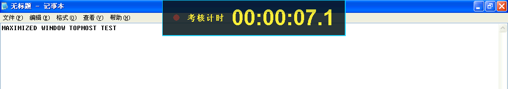

**2. 悬浮计时器实时运行在 XP 桌面上**（压在记事本窗口之上，秒数持续跳动）

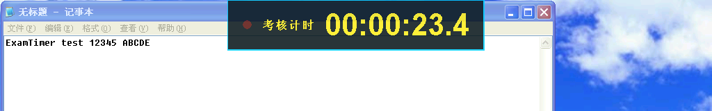

**3. 时间烧录进录像**（同一段视频的第 0 / 30 / 80 / 110 帧，时间随帧推进）

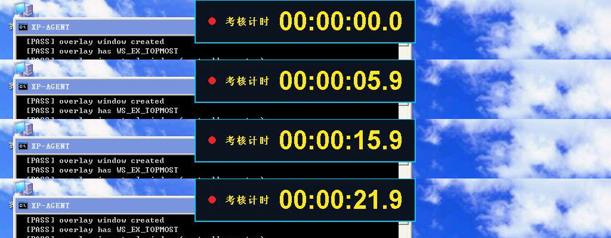

**4. 倒计时模式**（视频第 0 / 10 / 20 帧，30 秒倒计时递减）


**5. INI 配置全部生效**（左上角、绿色字、橙色边框、深紫底、中文标签、秒精度）


---

## 七、Windows 7 兼容性

由于没有真实 Windows 7 机器，采用两条证据链：

1. **二进制导入表分析**：`ExamTimer.exe` 仅导入
   `KERNEL32 / USER32 / GDI32 / SHELL32 / WINMM / MSVCRT` 中的
   XP 时代即存在的函数（`CreateDIBSection`、`SetLayeredWindowAttributes`、
   `QueryPerformanceCounter`、`Shell_NotifyIconW`、`timeGetTime` …），
   没有出现任何 Vista 之后才有的 API（`GetTickCount64`、`SetProcessDPIAware`、
   `InitializeCriticalSectionEx`、`AttachConsole` 等一律不用或改为动态加载）。
   **能在 XP SP3 上运行的导入表，必然也能在 Windows 7 上加载。**
2. **Windows 7 模式实机运行**：在 Wine 6.1（`windows 6.1 build 7601 Service Pack 1`）下，
   自检 **40/40 PASS**，并成功录制出可被 ffmpeg 正常解码的 AVI
   （1280×1024 @5 fps，31 帧，含烧录计时器）。

程序全部界面字符串使用宽字符 API，在英文/中文 Windows 7 上均不会乱码。

---

## 八、尚未覆盖 / 已知限制

* **独立全屏（DirectDraw 独占模式）程序**无法被任何窗口覆盖，这是 Windows 的固有限制，
  此时计时器不可见（录像里的烧录计时器仍然存在）。建议考核软件使用窗口或
  “无边框全屏窗口”模式。
* 仅录制**画面**，不录制声音。
* 多显示器按主显示器处理。
* 未在真实 Windows 7/10/11 物理机上运行（只有 Wine 7 模式 + 导入表分析）。
* 超过 2 GB 的单个 AVI 未做测试（程序内部强制 1800 MB 分卷，从设计上规避）。
* 极长时间（> 8 小时）连续录制未做整段测试；已验证 65 秒的稳定性与帧率无漂移。

---

## 九、整包验收测试（模拟用户实际使用）

把 `dist/` 目录中的**两个文件**（`ExamTimer.exe` + `examtimer.ini`）原样复制到 XP 上一个
全新目录 `C:\kaoshi\`，然后像用户一样直接启动（不附加任何命令行参数）：

| 步骤 | 结果 |
| --- | --- |
| 复制 2 个文件 | ✅ 414,660 字节 exe + 3,052 字节 ini |
| 双击启动 | ✅ 屏幕顶部立即出现计时器，并自动开始录制 |
| 观察 9 秒 | ✅ 计时器显示 `00:00:08.9`，压在最大化窗口之上 |
| 按 F9 停止 | ✅ 录像自动落盘 |
| 输出文件 | ✅ `C:\kaoshi\record\exam_20260925_173735.avi`（4,190,248 字节） |
| 回放校验 | ✅ 1024×768 MJPEG，47 帧 / 9.4 秒，ffmpeg 解码零错误，画面顶部计时器清晰（见下图） |

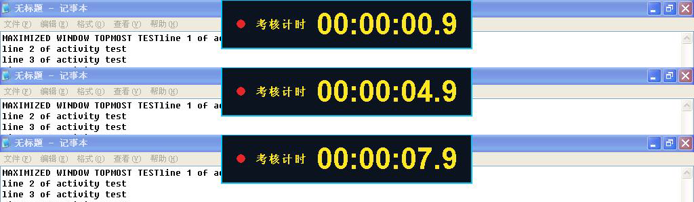

> 交付的 `dist/ExamTimer.exe` 与在 XP 真机上接受上述全部测试的可执行文件
> **SHA-256 完全一致**：
> `5e3a82e1c40f7593bab893c1f97778d872f3f9108bafbb9d135b2aa3a1d7ae9c`

---

## 十、复现方式

```bash
# 1. 构建
make                       # 需要 i686-w64-mingw32-gcc

# 2. 在目标机上自检
ExamTimer.exe --selftest --log C:\selftest.txt

# 3. 录制一段用于验证
ExamTimer.exe --run-seconds 10 --fps 5 --out C:\rec.avi --no-tray

# 4. 用任意播放器打开 C:\rec.avi，画面顶部应持续显示跳动的计时器
```

完整的自动化测试脚本与 XP 侧代理见 `test/` 目录：
`xp_server.py`（主机端控制服务）、`agent.vbs`（XP 侧代理）、
`xp.sh` / `xprun.sh` / `xpput.sh` / `xpget.sh`（驱动脚本）、
`runsuite.bat`（14 场景一键回归）。

---

# 附：2.0 修复与回归测试（2026-09-25 第二轮）

## A. 用户报告的 7 个问题与处理结果

| # | 问题 | 根因 | 处理 | XP 真机验证 |
| --- | --- | --- | --- | --- |
| 1 | 显示/隐藏计时器无效、计时器不能移动、文字不能改 | ①`do_command()` 里**漏了 `IDC_OVERLAY`/`IDC_CLICK`/`IDC_FOLDER`/`IDC_QUIT` 四个 case**，四个按钮根本没接线；②`overlay_resize()` 无条件带 `SWP_SHOWWINDOW`，隐藏后每 100ms 被时钟刷新重新显示；③没有修改文字的入口 | 补齐按钮分发；只有可见时才 `SWP_SHOWWINDOW`；新增**设置对话框**（文字/位置/字号/颜色…） | 点“隐藏计时器”→计时器消失；点“设置…”改文字→悬浮窗立即更新 |
| 2 | 打开录像目录无效；要能自定义目录 | `IDC_FOLDER` 未接线（同 1）；目录写死在配置里 | 接线按钮；新增保存目录 + 文件名模板 + “浏览…”（`SHBrowseForFolderW`） | 点“打开录像目录”弹出资源管理器；目录改为 `C:\考核录像\第一次考核` 后录像正常落盘 |
| 3 | 不要自动录像；录像与计时分开手动控制 | 1.0 只有一个 `g_state`，开始录像即开始计时，且 `autostart=1` | 拆成 `g_rec_state` / `g_tim_state` **两个独立状态机**，`autostart` 默认 0；`--duration` 改为按**录像时长**计算 | 实测：点“开始录像”后状态=录像中而计时器停在 `00:00:00.0`；再点“开始计时”才开始跳 |
| 4 | 鼠标穿透改为“固定/非固定” | 原概念是“穿透”，与“能否拖动”混在一起 | 改为 `fixed`：固定＝`WS_EX_TRANSPARENT`+不可移动；非固定＝可拖动且边框显示红色虚线 | 固定时 `WindowFromPoint` 返回下层窗口；非固定时鼠标拖动把计时器从顶部拖到屏幕下方成功 |
| 5 | 增加录音（本机声音 / 录音设备） | 1.0 无音频 | 新增 `audio.c`（waveIn + 环形缓冲 + 格式自动降级 + 设备枚举），AVI 增加 `01wb` PCM 第二路流；设置里可下拉选择设备 | XP 上枚举到 0 个设备（无音效卡）→ 用内置“测试用正弦波”验证：AVI 双流、5.2s、440Hz、ffmpeg 全解码 |
| 6 | 中文目录导致下方文字乱码 | 状态栏把 **UTF-8 的中文字面量**和 **GBK 的 Windows 路径**拼在同一个字符串里，再用“先按 UTF-8 解码”的统一转换，整串校验失败回退 GBK → 字面量变乱码 | 内部统一 UTF-8；路径一律走宽字符 API（`_wfopen`/`CreateDirectoryW`），Windows 返回的 ANSI 路径先转 UTF-8 再拼接 | 目录 `C:\考核录像\第一次考核`、文件名 `录像_%m%d_%H%M%S.avi`，状态栏与文件写入全部正常 |
| 7 | XP 录制时鼠标漂移 | `BitBlt(..., CAPTUREBLT)` 强制全屏重绘；叠加每 100ms 一次的 `SetWindowPos` | `captureblt` 默认改为 **0**；`overlay_resize()` 改成与**真实窗口矩形**比较，几何没变就完全不调用 `SetWindowPos` | 录像实测 `blt=0`、5.00 fps 无异常；窗口重排次数从 10 次/秒降到≈0 |

## B. 本轮新增修复的缺陷

| # | 缺陷 | 影响 | 修复 |
| --- | --- | --- | --- |
| C1 | **Makefile 没有头文件依赖** | 改了 `Config` 结构后 `audio.o`/`overlay.o` 未重编，静默按旧偏移读字段：音频初始化恒失败、悬浮窗定位算错 | 所有 .o 依赖全部头文件，`make clean` 重新验证 |
| C2 | AVI 头部尺寸/补丁偏移在加入音轨后写死 | 双流 AVI 的 `hdrl`/`strl`/`avih`/`strh` 长度会写错 | 改为写入时记录各字段偏移，收尾统一回填 |
| C3 | 设置对话框里“计时器文字”和“位置”两个标签叠在 x=16 | 文字输入框被遮住，用户看不到也改不了 | 重排布局，标签各占其位 |
| C4 | `位置` 下拉框索引与 `POS_*` 枚举顺序不一致 | 选“顶部居中”实际会存成左上角 | 增加 `pos_to_combo()` / `combo_to_pos()` 显式映射 |
| C5 | `overlay_set_style()` 只更新样式不更新锚点 | 在设置里改位置后不生效 | 改为 `overlay_apply(style, cfg)`，位置/偏移一起生效 |
| C6 | 设置保存的 ini 中英文混编 | 中文注释与路径编码不一致 | 整份文件按 UTF-8 组装后一次性转换为本地代码页 |
| C7 | `audio_read()` 依赖从未置位的 `g_cs_ready` | 音频读恒返回 0 | 统一走 `ensure_cs()` |

## C. 2.0 XP 真机回归结果

**内置自检**：`result: 44 passed, 0 failed`（Windows XP SP3 / 1024×768 / 16 位色）

```
[audio]      waveIn devices: 0           <- 该测试机（虚拟机 RDP 会话）无录音设备
             [PASS] synthetic audio source produces PCM data (44100 Hz 2ch 16bit)
[overlay]    [info] overlay rect = (327,0)-(697,73)      <- 顶部居中、贴住上边缘
             [PASS] overlay stays above another topmost window   (z-order 0 < 3)
             [PASS] overlay stays above a full-screen ordinary window (0 < 26)
             [PASS] clicks pass through the overlay (click-through on)
             [PASS] overlay receives clicks when click-through is off
[probe]      [info] layered windows visible in BitBlt capture: NO  <- 印证烧录的必要性
```

**14 个录像场景一键回归**（`runsuite2.bat`，72 秒跑完，全部 ALLDONE）：

| # | 场景 | 结果 |
| --- | --- | --- |
| T1–T10 | 基础/缩放/区域/倒计时/精度/分卷1MB(6段)/质量/4:4:4/关烧录/15fps | ✅ 全部生成并可解码 |
| T11 | 录音（测试正弦源） | ✅ 双流 AVI，26 帧 5.2s，音频 917,280 字节 = 5.2s |
| T12 | 录音 + **中文目录 + 中文文件名** | ✅ `C:\考核录像\第二场\测试录像.avi`，双流，5.2s |
| T13 | 非固定 + 右上角 | ✅ 烧录计时器出现在画面右上角 |
| T14 | 显式关闭录音 | ✅ 单流 AVI |

**回传文件解码校验**（ffprobe / ffmpeg）：

```
v2_t11.avi   mjpeg 1024x768  + pcm_s16le 44100Hz 2ch   6.2s   decode ok
v2_t12.avi   mjpeg 1024x768  + pcm_s16le 44100Hz 2ch   5.2s   decode ok
v2_t13.avi   mjpeg 1024x768                            5.2s   decode ok
xp_aud.avi   mjpeg 1024x768  + pcm_s16le 44100Hz 2ch   5.2s   decode ok
             音频实测 439.5 Hz / 峰值 11999（合成源为 440Hz/12000）✔
```

**性能（XP，1024×768，captureblt=0）**：5 fps 稳定 5.00 fps，抓屏+烧录+编码 32.8 ms/帧（含音频合流）。

## D. 2.0 证据截图

**录像中但计时器未启动**（状态=录像中，时间停在 00:00:00.0）

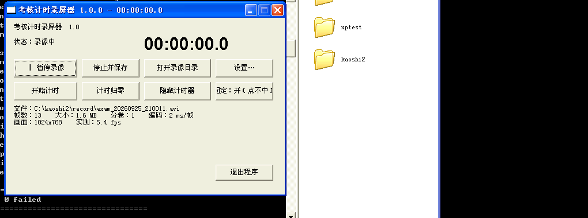

**设置对话框**（可改保存目录、计时器文字、位置、声音来源等）

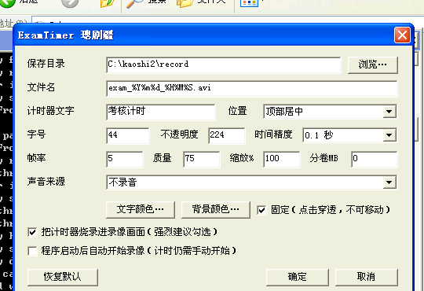

**中文目录 + 中文文件名**（状态栏无乱码，文件正常写入）

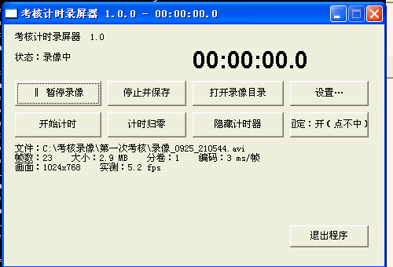

**非固定状态**（红色虚线边框表示可拖动）


**拖动后的计时器**（从顶部拖到屏幕下方，按钮显示“固定：关（可拖动）”）

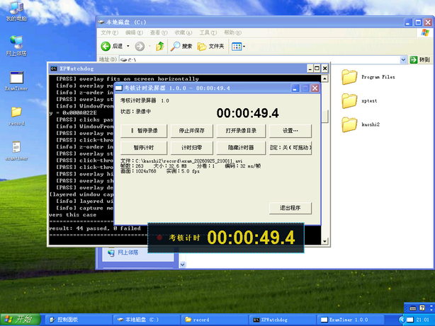

**按“隐藏计时器”后屏幕顶部干净无计时器**


## E. 2.0 交付校验

```
dist/ExamTimer.exe   sha256 7cabdef12fdc1b71cf12cab4116ca0639efd582051741d83ace289454f2d06a7
XP 真机上的 exe       sha256 7cabdef12fdc1b71cf12cab4116ca0639efd582051741d83ace289454f2d06a7
                     -> 字节完全一致
```

---

# 附：2.0.0 第三轮修复（2026-10-14）

## A. 用户报告的 11 个问题与处理

| # | 问题 | 根因 | 处理 | XP 真机验证 |
| --- | --- | --- | --- | --- |
| 1 | 程序目录含中文且**没有 ini** 时状态栏乱码（有 ini 就正常） | `GetModuleFileNameA` 返回 GBK 字节，与程序内部的 UTF-8 字面量拼接后整串 UTF-8 校验失败 → 回退 GBK → 字面量变乱码。有 ini 时路径来自 ini（UTF-8）所以正常 | 改用 `GetModuleFileNameW` + 统一 UTF-8；新增 `normalize_path_utf8()` 在边界归一化；路径读写全部改宽字符 API | 把 exe 放在 `C:\考核录像\中文目录无ini` 且删除 ini，状态栏显示 `保存目录：C:\考核录像\中文目录无ini\record`，无乱码 |
| 2 | 设置二级界面标题栏乱码 | `CreateWindowExA` + 含中文的窄字符串字面量 | 改 `CreateWindowExW` 宽字符标题 | 标题正确显示 `ExamTimer 设置` |
| 3 | 版本号仍显示 1.0.0，文件属性无信息 | `APP_VERSION` 没跟着改；没有 VERSIONINFO 资源 | 版本号改 2.0.0；新增 `src/version.rc`（VC 版本资源，含文件说明/产品名/公司/版权/注释）并用 windres 编译进 exe | 标题栏显示 `ExamTimer 2.0.0`；资源内含 VS_FIXEDFILEINFO(filever=2.0.0.0) 与完整 StringFileInfo；资源管理器已直接显示“考核计时录屏器 …”和“dengmotong” |
| 4 | 希望上传 GitHub | — | 建立 git 仓库、`.gitignore`、MIT LICENSE、分主题提交并推送到 `github.com/dengmotong/examtimer` | 见第五节 |
| 5 | 去掉“烧录”选项，改为隐藏即不烧录 | 选项多余 | 删除设置里的烧录复选框；烧录固定开启；**烧录前检查悬浮窗是否可见**，隐藏时录像里也没有计时器 | F11 隐藏后录像：计时器区域黄色像素 0 个；显示时 80,886 个 |
| 6 | 拖动计时器后录像里位置仍在原地 | 烧录用的是配置里的锚点（`g_cfg.pos`），而拖动只改了 overlay 模块自己的锚点；只有手动选“自定义”才一致 | 烧录改为**直接查询悬浮窗的真实矩形**；`overlay_get_geometry` 修正为返回锚点而非绝对坐标；拖动/缩放结果每秒同步回配置并在退出时保存 | 拖动到 (175,384) 并放大后录像，画面中计时器就在该位置且尺寸同步；ini 保存 `pos=3 / offset_x=175 / offset_y=384` |
| 7 | 需要自定义调整计时器大小 | 只能改 ini 字号 | ① 设置里“计时器大小”输入框 + `－`/`＋` 按钮；② **活动状态**下用鼠标拖计时器右下角即可缩放（按下时按高度比例换算字号） | 拖右下角后计时器明显变大；`＋` 点 3 次后字号 44→56 并生效 |
| 8 | “固定”文案太冗余 | — | 按钮/菜单/复选框统一为 `固定计时器` / `活动计时器` | 面板与右键菜单均为精简文案 |
| 9 | 活动状态下右键菜单被计时器盖住 | 菜单属于非置顶的主窗口，而计时器是 TOPMOST | 菜单改为**由悬浮窗自己拥有**（弹出菜单继承拥有者的置顶属性），并在 overlay 里把 `WM_COMMAND` 转发给主窗口 | 菜单全部 8 项完整可见（含“开始/暂停录像”等顶部项）；点“设置…”能正常打开设置窗口 |
| 10 | 设置需要“应用”按钮 | — | 新增 `应用` 按钮（不关闭窗口即生效并写 ini） | 点“应用”后 ini 立即生成（675 字节，含中文目录） |
| 11 | 取消统一不透明度，改为文字/背景分别设置且放进颜色三级菜单 | 单一 `alpha` 无法分别控制 | 删除主界面“不透明度”；`文字颜色/不透明度…`、`背景颜色/不透明度…` 两个三级对话框各含取色器 + 不透明度滑杆 + 棋盘格预览；渲染改用 `UpdateLayeredWindow` + 自写 ARGB 合成，真正实现分层透明 | 设文字 80% 后 ini 写入 `fg_alpha=204 / bg_alpha=224`；悬浮窗呈现“半透明底板 + 不透明文字” |

## B. 本轮新增修复的缺陷

| # | 缺陷 | 影响 | 修复 |
| --- | --- | --- | --- |
| D1 | `timer_box_render_argb` 返回指向已 `DeleteObject` 的 DIB 内存 | 输出层一渲染就崩溃/花屏 | 改为 `malloc` 输出并在删除 DIB 前完成合成 |
| D2 | 掩膜里把背景底板也画成白色 | 整个计时器变成纯前景色方块 | 掩膜只画前景层（边框/红点/文字），底板作为独立半透明层 |
| D3 | 重写悬浮窗时漏掉 `overlay_set_text` 里的 `ensure_cs()` | **`--no-overlay` 时对未初始化临界区操作 → XP 上崩溃**（弹出“遇到问题需要关闭”，还让整个批处理卡死） | 所有进入临界区的入口都先 `ensure_cs()`；并用 `--no-overlay` 单独回归 |
| D4 | `overlay_get_geometry` 把绝对屏幕坐标当锚点偏移返回 | 配置被写成 `pos=topcenter, offset_x=327`，下次启动位置跑偏 | 改为返回真实锚点 |
| D5 | 三级颜色对话框用 `RegisterClassW` 时标题仍乱码 | 标题栏乱码 | 类改 `RegisterClassA` + 创建后用 `SetWindowTextW` 显式设置标题 |

## C. 2.0.0 回归结果

* **内置自检**：XP 真机 `44 passed, 0 failed`；Windows 7 模式（Wine）`44 passed, 0 failed`
* **14 场景一键回归**（`runsuite3.bat`，含音频、中文目录、分卷、15fps）：**77 秒跑完，ALLDONE**
* **烧录跟随拖动/缩放**：录像帧中计时器位于拖动后的位置且尺寸同步
* **隐藏即不烧录**：隐藏后录像计时器区域黄色像素 0（显示时 80,886）
* **中文目录无 ini**：状态栏、录像落盘、ini 写入全部正常
* **性能**：5 fps 稳定 5.00 fps，抓屏+烧录+编码 35.3 ms/帧（含 ARGB 合成）

## D. 证据截图

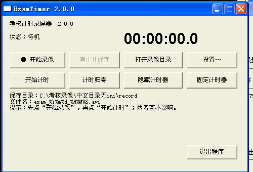

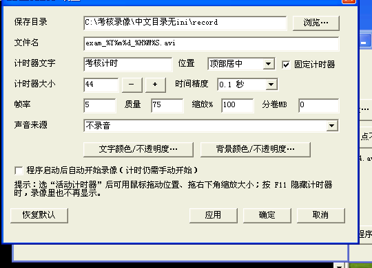

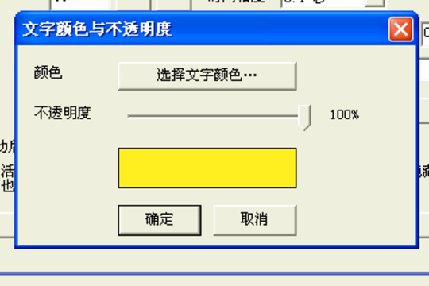

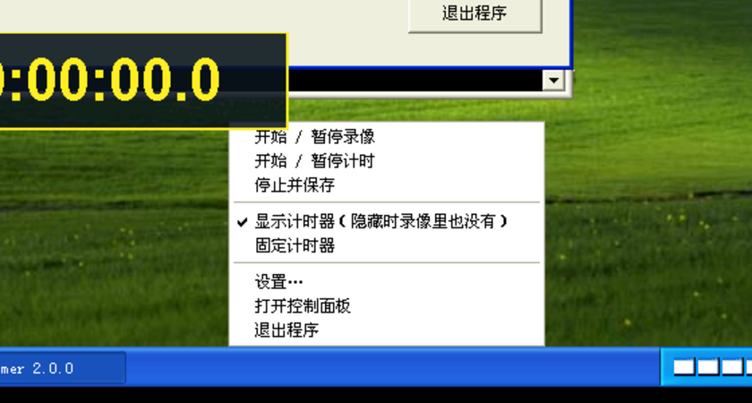

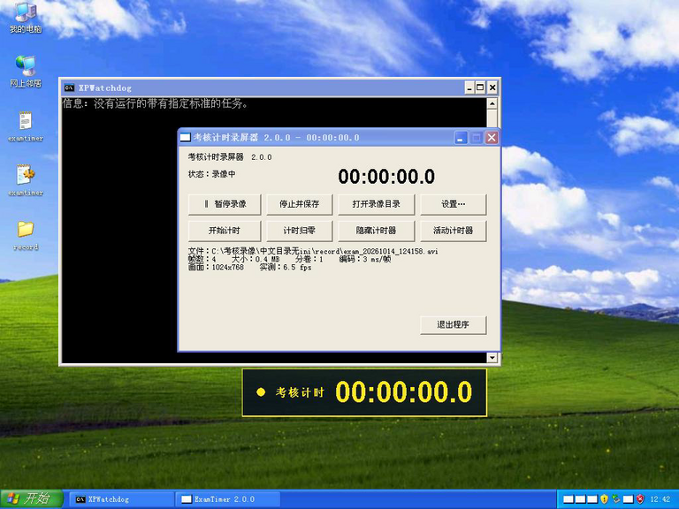
